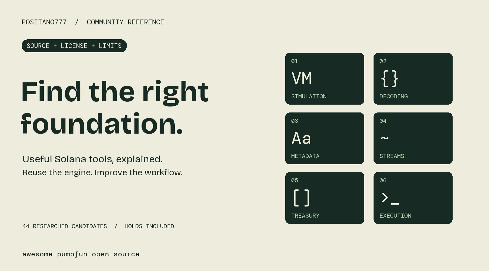

# Awesome Pumpfun Open Source

A researched catalog of Solana and pump.fun tools, maintained by [Positano777](https://x.com/positano777). Find useful foundations, understand their limits, and contribute improvements upstream.

## Start here

| Need | Starting point | Review status |
| --- | --- | --- |
| Launch evidence and creator outflows | [RugHawk](https://github.com/bobvasic/rughawk) | MIT source inspected; not independently runtime-validated |
| Our launch evidence export | [Community toolbox](https://github.com/Positano777/pumpfun-community-tools) | Attributed RugHawk fork; developer preview |
| Transaction decoding and indexing | [Carbon](https://github.com/sevenlabs-hq/carbon) | MIT framework with Pumpfun decoder |
| Live Solana streams | [Yellowstone gRPC](https://github.com/rpcpool/yellowstone-grpc) | Component-specific AGPL / Apache licenses |
| Current protocol interfaces | [Official Pump docs](https://github.com/pump-fun/pump-public-docs) | Docs and SDK package leads; not all source repos accessible |
| Smart-money dashboard and copy trading | [Million](https://github.com/Kelows/million) | MIT, experimental; execution review needed |
| Rust SDK | [pumpfun-rs](https://github.com/nhuxhr/pumpfun-rs) | MIT OR Apache-2.0; current compatibility unverified |

## Specialized tools worth studying

The catalog now covers **44 researched candidates**, including held and unresolved entries. These upstream tools solve different problems; this community did not author their engines. Read [source-backed specialized notes](SPECIALIZED.md) before adopting one.

| Need | Upstream foundation | Useful community contribution |
| --- | --- | --- |
| Reproduce transaction behavior locally | [LiteSVM](https://github.com/LiteSVM/litesvm) | Simulation fixtures and understandable balance-change reports |
| Stress-test program invariants | [Trident](https://github.com/Ackee-Blockchain/trident) | Small reusable fuzzing harnesses |
| Build transactions and RPC clients | [Solana Kit](https://github.com/anza-xyz/kit) | Documented transaction adapters |
| Inspect metadata | [Umi](https://github.com/metaplex-foundation/umi) | URI and update-authority diagnostics |
| Track generated client compatibility | [Codama](https://github.com/codama-idl/codama) | Versioned IDL fixtures; license-body confirmation remains pending |
| Deliver wallet event alerts | [Helius SDK](https://github.com/helius-labs/helius-sdk) | Optional managed-provider adapters; API costs apply |
| Connect browser wallets | [Wallet Adapter](https://github.com/anza-xyz/wallet-adapter) | Minimal connection and transaction-review examples |
| Explain treasury proposals | [Squads v4](https://github.com/Squads-Protocol/v4) | Read-only proposal views; confirm component license scope |

**Important holds:** Orca Whirlpools has current field-of-use restrictions. Squads' root and SDK manifest differ. Solana Verify's manifest and license-file evidence need reconciliation. Those are research leads, not blanket permissive reuse recommendations.

## Beyond Solana: researched crypto opportunities

The [broader crypto shortlist](CRYPTO_OPPORTUNITIES.md) ranks five bounded contributions: route availability diagnostics, exchange CSV import audits, EVM data health reports, stablecoin receipt matching, and permission provenance fixtures. It links existing foundations and separates open requests from fixed bugs. Read the [full 2026-10-22 report](research/crypto-opportunities-2026-10-22.md) and [20-row evidence ledger](research/crypto-opportunity-evidence.csv). These are research hypotheses, not shipped integrations or validated market demand.

The first receipt prototype is now in the [community toolbox](https://github.com/Positano777/pumpfun-community-tools/tree/main/receipt): offline browser viewer and read-only CLI with explicit unexplained amounts. It reuses attributed VTX Labs decoding code and does not calculate full trading PnL.

## Memecoin creation handbook

Start with the [A-to-Z Memecoin Launch Handbook](https://github.com/Positano777/memecoin-launch-handbook) for separate pump.fun and self-managed SPL paths, 26 chapters, 16 public templates, and offline plan checks. It is educational documentation and planning software, not a token launch service.

## Use this reference

- **Builders:** choose a foundation, inspect its license, pin the revision, and test the integration.
- **Researchers:** submit reproducible corrections, examples, or license evidence.
- **Community members:** start with a concrete problem, not a promise of trading returns.

Available community software: [launch-evidence toolbox](https://github.com/Positano777/pumpfun-community-tools) and [IDL Drift Watch](https://github.com/Positano777/idl-drift-watch), an original offline IDL structural checker. The specialized integrations above are proposals, not shipped community adapters.

## How to read this catalog

This is a practical inventory, not an exhaustive list or endorsement. Research date: **2026-10-21**. Source inspection is not a security audit or a successful runtime test. Push dates do not establish quality. Trade-execution candidates require additional compatibility, transaction, dependency, and signing review.

Public source does not automatically grant reuse rights. Several discovered repositories have proprietary or unresolved licenses. They appear below for research transparency and are **not** recommended as open-source fork bases. Verify the current LICENSE and exact revision before reuse. Same-slot activity does not prove a Jito bundle or dishonest coordination.

**Data:** [CSV](data/repositories.csv) / [JSON](data/repositories.json). **Full source-backed assessment:** [REVIEW.md](REVIEW.md).

## Complete reviewed inventory

### Wallet PnL research

| Candidate | License evidence | Recommendation | Limits |
| --- | --- | --- | --- |
| [haccer/pumpfun-research](https://github.com/haccer/pumpfun-research) | No verified license; API null | Hold reuse; useful real Python methodology | License and PnL correctness unverified |

### Wallet balances

| Candidate | License evidence | Recommendation | Limits |
| --- | --- | --- | --- |
| [maseurodrigo/SolTrack](https://github.com/maseurodrigo/SolTrack) | MIT file inspected | Secondary prototype reference | Not Rust desktop or validated trade PnL; public passphrase design needs review |

### Developer identity; name collision

| Candidate | License evidence | Recommendation | Limits |
| --- | --- | --- | --- |
| [chrsow/soltrack](https://github.com/chrsow/soltrack) | Not checked | Exclude from wallet-PnL shortlist | Unrelated Rust crate; source owner from docs.rs |

### Wallet PnL showcase

| Candidate | License evidence | Recommendation | Limits |
| --- | --- | --- | --- |
| [katlogic/solana-wallet-analytics-telegram-tool](https://github.com/katlogic/solana-wallet-analytics-telegram-tool) | No verified license | Reject as implementation base | Screenshots only in public directory |

### Smart-money dashboard

| Candidate | License evidence | Recommendation | Limits |
| --- | --- | --- | --- |
| [nirholas/kol-quest](https://github.com/nirholas/kol-quest) | Proprietary LICENSE | Exclude current source from OSS reuse | Description does not override LICENSE; no runtime validation |

### Copy trading

| Candidate | License evidence | Recommendation | Limits |
| --- | --- | --- | --- |
| smart-money-shadow [owner unresolved] | Unknown | Hold; exact repository needed | No verified owner or primary URL |

### Wallet Discord alerts

| Candidate | License evidence | Recommendation | Limits |
| --- | --- | --- | --- |
| [AccursedGalaxy/Insider-Monitor](https://github.com/AccursedGalaxy/Insider-Monitor) | README MIT; no verified root grant | Hold license; review source | Balance changes do not establish insiders; committed binary not run |

### Copy trading; paper and live execution

| Candidate | License evidence | Recommendation | Limits |
| --- | --- | --- | --- |
| [Kelows/million](https://github.com/Kelows/million) | MIT file inspected | Shortlist for detailed source and execution review | Experimental; no runtime security or compatibility validation |

### Telegram launch and whale alerts

| Candidate | License evidence | Recommendation | Limits |
| --- | --- | --- | --- |
| [nirholas/pumpkit](https://github.com/nirholas/pumpkit) | Proprietary LICENSE | Exclude current source from OSS reuse | Source exists but reuse restricted |

### Telegram wallet swap alerts

| Candidate | License evidence | Recommendation | Limits |
| --- | --- | --- | --- |
| [DracoR22/handi-cat_wallet-tracker](https://github.com/DracoR22/handi-cat_wallet-tracker) | No verified license; API null | Hold copying pending license | Source exists; not executed |

### Live tokens; charts; paper trading

| Candidate | License evidence | Recommendation | Limits |
| --- | --- | --- | --- |
| [nathanliow/pumpscope](https://github.com/nathanliow/pumpscope) | No verified license; API null | Reference only; hold reuse | Non-production exploration |

### Wallet screening; CSV

| Candidate | License evidence | Recommendation | Limits |
| --- | --- | --- | --- |
| [OkoyaUsman/solana-wallet-analyzer](https://github.com/OkoyaUsman/solana-wallet-analyzer) | MIT API and root evidence | Secondary small Python candidate | Birdeye dependency; not pump-specific; not run |

### Creation-slot launch and risk analysis

| Candidate | License evidence | Recommendation | Limits |
| --- | --- | --- | --- |
| [bobvasic/rughawk](https://github.com/bobvasic/rughawk) | MIT LICENSE inspected | Primary detector base; contribution or focused fork | Tests inspected not run; same-slot coordination inferred; paid hosting not source restriction |

### Bundle clustering; educational toolkit

| Candidate | License evidence | Recommendation | Limits |
| --- | --- | --- | --- |
| [smokyrudeboys/onchain-agent-toolkit](https://github.com/smokyrudeboys/onchain-agent-toolkit) | MIT API evidence | Reference; rewrite detector | Latest-100 sampling does not locate mint creation or verify buys |

### Safety and bundle detector

| Candidate | License evidence | Recommendation | Limits |
| --- | --- | --- | --- |
| [drixindustries/Rug-Killer-On-Solana](https://github.com/drixindustries/Rug-Killer-On-Solana) | MIT API evidence | Do not adopt current detector | Source invents wallet IDs from signatures; error returns clean result |

### Hosted forensic API client

| Candidate | License evidence | Recommendation | Limits |
| --- | --- | --- | --- |
| [paulf280-ui/cabal-hunter-mcp](https://github.com/paulf280-ui/cabal-hunter-mcp) | MIT client repository | UX and terminology comparison | Backend openness and implementation not verified |

### Browser extension; Jito inspection

| Candidate | License evidence | Recommendation | Limits |
| --- | --- | --- | --- |
| [0slot Solscan Jito Bundle Detector [repository unresolved]](https://0slot.trade/tools.html) | Provider says open source; source/license not inspected | Investigate ZIP and license before reuse | Not a verified GitHub repo or token launch scanner |

### Dataset and ML benchmark; formerly MemeTrans

| Candidate | License evidence | Recommendation | Limits |
| --- | --- | --- | --- |
| [git-disl/MELT](https://github.com/git-disl/MELT) | CC BY-NC 4.0 | Benchmark lead; commercial permission review | Noncommercial restriction; not permissive software base |

### Python token safety

| Candidate | License evidence | Recommendation | Limits |
| --- | --- | --- | --- |
| [aethernet404/rugcheck](https://github.com/aethernet404/rugcheck) | No verified license; API null | Hold copying pending license | Bundler feature roadmap; MIT claim unsupported |

### Token safety library

| Candidate | License evidence | Recommendation | Limits |
| --- | --- | --- | --- |
| [degenfrends/solana-rugchecker](https://github.com/degenfrends/solana-rugchecker) | Package MIT; root grant unverified | Reference or modernization after clarification | False-result warning; no verified bundle detector |

### Token safety

| Candidate | License evidence | Recommendation | Limits |
| --- | --- | --- | --- |
| [Rezzecup/pump-fun-rug-checker-lite](https://github.com/Rezzecup/pump-fun-rug-checker-lite) | Unknown | Do not recommend current availability | Indexed topic mention only |

### SDK; execution and launch

| Candidate | License evidence | Recommendation | Limits |
| --- | --- | --- | --- |
| [nirholas/pump-fun-sdk](https://github.com/nirholas/pump-fun-sdk) | Proprietary LICENSE conflicts with package Apache-2.0 | Hold current source reuse | Actual source inspected; no current compatibility tests |

### Creator fee analytics

| Candidate | License evidence | Recommendation | Limits |
| --- | --- | --- | --- |
| [nirholas/pumpfun-creator-rewards](https://github.com/nirholas/pumpfun-creator-rewards) | Proprietary; July 2026 license-change history | Exclude current source from OSS reuse | Features largely README; pooled withdrawals attribution uncertain |

### Creator fee claiming; key handling

| Candidate | License evidence | Recommendation | Limits |
| --- | --- | --- | --- |
| [nirholas/pumpvault](https://github.com/nirholas/pumpvault) | Package MIT; LICENSE grant not verified | Hold license and code review | No custody audit or runtime validation |

### Treasury fee routing

| Candidate | License evidence | Recommendation | Limits |
| --- | --- | --- | --- |
| [16usa/Pump-Fee-Routing](https://github.com/16usa/Pump-Fee-Routing) | Unknown | Hold; exact accessible source required | Direct and exact-name checks did not verify repository |

### Official protocol documentation and IDLs

| Candidate | License evidence | Recommendation | Limits |
| --- | --- | --- | --- |
| [pump-fun/pump-public-docs](https://github.com/pump-fun/pump-public-docs) | No root license verified | Primary protocol reference; not product fork | Specific IDL redistribution license should be checked |

### Official @pump-fun/pump-sdk package; execution

| Candidate | License evidence | Recommendation | Limits |
| --- | --- | --- | --- |
| [pump-fun/pump-sdk [advertised repo inaccessible]](https://www.npmjs.com/package/@pump-fun/pump-sdk) | npm declares MIT; exact package payload not inspected | Prefer version-pinned package review; not verified public fork base | GitHub 404; exact package source/license and tests unverified |

### Official @pump-fun/pump-swap-sdk package; execution

| Candidate | License evidence | Recommendation | Limits |
| --- | --- | --- | --- |
| [pump-fun/pump-swap-sdk [advertised repo inaccessible]](https://www.npmjs.com/package/@pump-fun/pump-swap-sdk) | Exact package license not inspected | Package candidate pending payload review | GitHub 404; npm access limited |

### Legacy TypeScript SDK; actual execution

| Candidate | License evidence | Recommendation | Limits |
| --- | --- | --- | --- |
| [rckprtr/pumpdotfun-sdk](https://github.com/rckprtr/pumpdotfun-sdk) | MIT repository evidence | Legacy reference; hold live current-protocol use | Old builders and current account/fee compatibility untested |

### Rust SDK; execution and optional streaming

| Candidate | License evidence | Recommendation | Limits |
| --- | --- | --- | --- |
| [nhuxhr/pumpfun-rs](https://github.com/nhuxhr/pumpfun-rs) | MIT OR Apache-2.0; both files | Conditional Rust foundation after compatibility review | 2026 protocol coverage and signing untested |

### Rust indexing and Pumpfun decoder

| Candidate | License evidence | Recommendation | Limits |
| --- | --- | --- | --- |
| [sevenlabs-hq/carbon](https://github.com/sevenlabs-hq/carbon) | MIT LICENSE inspected | Strong decoder dependency candidate | Not a bundle detector; no execution tests run here |

### Live transaction streaming

| Candidate | License evidence | Recommendation | Limits |
| --- | --- | --- | --- |
| [rpcpool/yellowstone-grpc](https://github.com/rpcpool/yellowstone-grpc) | Server AGPL-3.0-only; specified clients/proto/examples Apache-2.0 | Strong ingestion dependency; respect component license | Hosted service and historical access not included |

### Parsing and wallet examples

| Candidate | License evidence | Recommendation | Limits |
| --- | --- | --- | --- |
| [Shyft-to/solana-defi](https://github.com/Shyft-to/solana-defi) | No verified root license | Reference only pending license | Hosted connectivity may be required |

### Historical Pumpkit protocol audit reference

| Candidate | License evidence | Recommendation | Limits |
| --- | --- | --- | --- |
| [nirholas/atomic](https://github.com/nirholas/atomic) | Not assessed | Documentation reference only | Historical typecheck findings do not establish current failures |

## Specialized inventory additions

| Candidate | License evidence | Action | Limits |
| --- | --- | --- | --- |
| [LiteSVM/litesvm](https://github.com/LiteSVM/litesvm) | Apache-2.0 LICENSE inspected | Depend; build reproducible transaction test fixtures and simulation reports | Not a guarantee of mainnet execution; pin runtime feature set and account snapshots |
| [Ackee-Blockchain/trident](https://github.com/Ackee-Blockchain/trident) | MIT LICENSE inspected | Depend; publish community fuzz harnesses and invariant examples | Pre-release toolchain; framework use does not constitute a security audit |
| [anza-xyz/kit](https://github.com/anza-xyz/kit) | MIT text in LICENSE inspected | Depend; reusable RPC and transaction explainers with explicit SDK version support | API differs from web3.js 1.x; ecosystem adapters need compatibility testing |
| [metaplex-foundation/umi](https://github.com/metaplex-foundation/umi) | MIT LICENSE inspected | Depend; metadata integrity inspector with JSON and content checks | Umi license does not establish licenses of every Metaplex program or plugin; uploads may cost money |
| [codama-idl/codama](https://github.com/codama-idl/codama) | GitHub labels MIT; LICENSE file body not retrieved | Conditional depend; generate versioned decoders and IDL drift reports | Inspect pinned LICENSE text and renderer licenses before vendoring; generated output accuracy follows IDL accuracy |
| [helius-labs/helius-sdk](https://github.com/helius-labs/helius-sdk) | MIT LICENSE inspected | Optional provider adapter; wallet event feeds and alert delivery examples | SDK open source does not make hosted APIs free or self-hostable; some methods can pay/sign |
| [anza-xyz/wallet-adapter](https://github.com/anza-xyz/wallet-adapter) | Apache-2.0 LICENSE inspected | Depend; transparent wallet connection and transaction review UI | Use minimal required packages; burner adapter is for development; connecting wallet is not safety certification |
| [Squads-Protocol/v4](https://github.com/Squads-Protocol/v4) | Root AGPL-3.0 inspected; sdk/multisig/package.json declares MIT | Conditional link and SDK integration; community treasury activity and proposal viewer | Confirm component license scope before copying SDK source; do not label whole repo MIT |
| [solana-foundation/solana-verifiable-build](https://github.com/solana-foundation/solana-verifiable-build) | Cargo.toml declares MIT; no root LICENSE found in inspected tree | Link; add verifiable-build status to evidence reports; hold vendoring pending license clarification | Matching source and deployed bytes does not prove program safety; license text not retrieved |
| [orca-so/whirlpools](https://github.com/orca-so/whirlpools) | Current root Orca License restricts non-commercial and competitor uses; replaced Apache-2.0 from 2025-02-27 | Reference only; hold adoption under unrestricted-open-source policy | Repository description says open source but current LICENSE has field-of-use restrictions; exact package exceptions unverified |

## Contribute

See [CONTRIBUTING.md](CONTRIBUTING.md). Useful submissions provide a source repository, exact license evidence, maintenance date, actual implementation, and known limits. Maintainers and authors can submit corrections with primary evidence. Execution tools are welcome; hidden signing, binary-only offers, and promotional placeholders are not ready-to-use recommendations.

## Licensing and attribution

Catalog text and original data are CC0-1.0; [LICENSE](LICENSE) explains the dedication. Listed software retains its own license. Attribution is encouraged. No affiliation with Pump, Solana, Jito, or upstream maintainers is implied.
